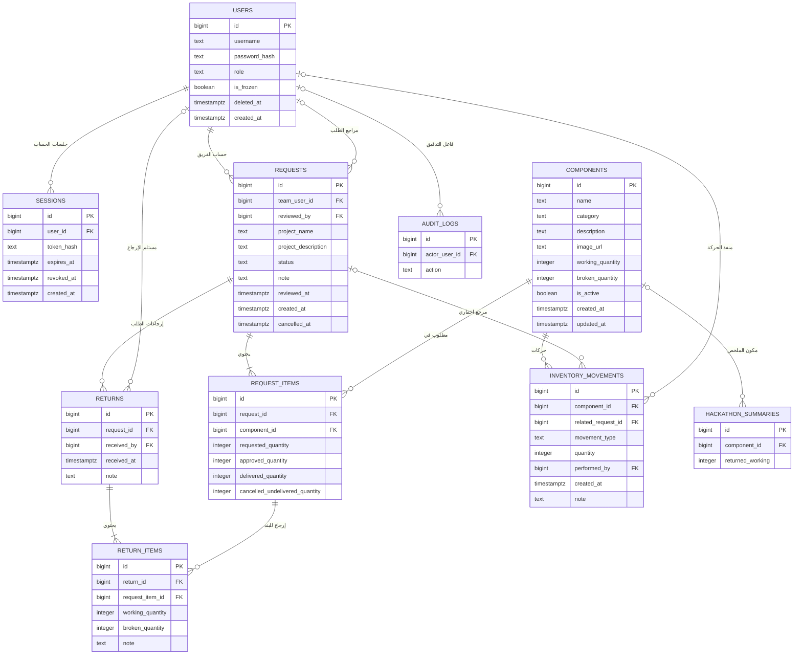

# مراجعة ERD — نظام مخزون نادي Hamak AI & Robotics

## 1. نظرة عامة على المهمة

تراجع هذه الوثيقة مخطط ERD المصوّر المرفق بعنوان «06A — مخطط العلاقات ERD»، وتقارنه بمتطلبات الخطة التي نقلها المستخدم وبمخطط Prisma الموجود في مساحة العمل. الهدف هو مراجعة المخطط المقدم والبناء عليه، مع فصل ما يظهر فيه فعلًا عن التحسينات المقترحة. تشمل المراجعة الحسابات والطلبات والتسليم والإرجاع والمخزون والتقارير وإعادة ضبط الهاكاثون.

### نطاق الأدلة وحالة المتطلبات

- **خط الأساس الذي تمت مراجعته:** الصورة المرفقة تعرض ERD بكيانات `users`, `sessions`, `components`, `requests`, `request_items`, `returns`, `return_items`, `inventory_movements`, `audit_logs`, و`hackathon_summaries`. تظهر فيها حقول وعلاقات محددة، وتلخصها هذه المراجعة أدناه.
- **حدود التحقق:** الصورة هي مخطط ERD وليست مواصفة كاملة؛ الجزء السفلي من الصورة غير ظاهر بالكامل، كما لم تتوفر نسخة مستقلة من الخطة الرسمية للتحقق من كل قواعد العمل. لذلك تُنسب تفاصيل المخطط إلى الصورة، وتُنسب قواعد العمل الأخرى إلى البنود التي نقلها المستخدم، ولا تُعامل التوصيات كمتطلبات مؤكدة.
- **تصحيح مهم:** العبارة السابقة في هذه الوثيقة التي أفادت بعدم ظهور ERD كانت غير دقيقة؛ المخطط المرفق موجود وقد تمت مراجعته. كذلك توجد بالفعل ملفات Prisma وتنفيذ قاعدة بيانات في مساحة العمل، لذا فهذه المراجعة تخص مواءمة التصميم والتطوير اللاحق، لا قرار بدء Prisma من الصفر.
- **توصية:** أي بنية أو قيد إضافي أدناه غير ظاهر في الصورة موسوم بأنه اقتراح أو سؤال يحتاج حسمًا من الكوتش.

## 2. الكيانات الظاهرة ومسؤولياتها

| الكيان/الجدول | ظهوره في ERD المرفق | المسؤولية وملاحظة التصميم |
|---|---|---|
| `users` | ظاهر في ERD المرفق | يتضمن `username`, `password_hash`, `role (admin / user)`, `is_frozen`, و`deleted_at`؛ لا يظهر جدول `teams` أو `roles` مستقل. |
| `sessions` | ظاهر في ERD المرفق | مرتبط بـ `users`; تظهر حقول بصمة الرمز والانتهاء والإبطال والإنشاء. |
| `components` | ظاهر في ERD المرفق | تظهر حقول الاسم والتصنيف والوصف والصورة وكميات العامل والمعطوب وحالة التفعيل. |
| `requests` | ظاهر في ERD المرفق | `team_user_id` و`reviewed_by` كلاهما يشيران إلى `users.id`؛ تظهر بيانات المشروع والحالة والملاحظة وتواريخ المراجعة والإنشاء والإلغاء. |
| `request_items` | ظاهر في ERD المرفق | تظهر الكميات المطلوبة والمعتمدة والمسلمة والملغاة غير المسلمة لكل بند. |
| `returns` | ظاهر في ERD المرفق | مرتبط بالطلب، ويظهر المستلم ووقت الاستلام وملاحظة. |
| `return_items` | ظاهر في ERD المرفق | يرتبط بـ `returns` وبـ `request_items`، ويفصل الكميات العاملة والمعطوبة. |
| `inventory_movements` | ظاهر في ERD المرفق | يرتبط بالمكون، ويمكن ربطه اختياريًا بالطلب؛ تظهر نوع الحركة والكمية والمنفذ والوقت والملاحظة. |
| `audit_logs` | ظاهر في ERD المرفق | يظهر فاعل التدقيق والإجراء؛ بقية الحقول غير واضحة في الصورة. |
| `hackathon_summaries` | ظاهر جزئيًا في ERD المرفق | يظهر `component_id` مرتبطًا بالمكونات و`returned_working`؛ بقية الحقول غير ظاهرة بالكامل. |
| `deliveries`, `delivery_items`, `teams`, `roles` | لا تظهر في ERD المرفق | اقتراحات بنيوية محتملة فقط؛ لا ينبغي وصفها ككيانات موجودة في المخطط الأصلي. |
| التقارير والإحصائيات | المخرجات مطلوبة؛ جدول تقارير غير مؤكد | تقارير المخزون والطلبات والحركات والإحصائيات؛ يمكن إنتاجها باستعلامات دون جداول تخزين إضافية. |

الأسماء العشرة الأولى في الجدول أعلاه هي الكيانات الظاهرة في ERD المرفق، وليست مجرد قائمة استنتجت من وصف المهمة. المخطط يجعل حساب الفريق نفسه مستخدمًا عبر `requests.team_user_id`; ولا يفرض جدول `teams` أو `roles`. كما أن `request_items` يحتوي `delivered_quantity` و`cancelled_undelivered_quantity`، لذلك لا يصح القول إن دعم التسليم الجزئي يتطلب حتمًا جدولَي `deliveries` و`delivery_items`. قد يلزم سجل دفعات منفصل فقط إذا كان المطلوب حفظ كل واقعة تسليم وتوقيتها ومنفذها وربطها ببند بعينه.

الطلبات والمكونات علاقة متعدد-إلى-متعدد عبر `request_items`. يعرض المخطط الإرجاع مرتبطًا مباشرة ببند الطلب، لا بسجل تسليم مستقل. هذا يكفي لتجميع الكميات على مستوى البند، لكنه لا يتيح وحده معرفة أي دفعة تسليم أُعيدت منها القطع إذا كانت هناك دفعات متعددة. لا تظهر علاقة واحد-إلى-واحد مطلوبة صراحة.

## 3. وصف الجداول والحقول ومقارنتها بالتنفيذ

### الفروقات بين ERD المرفق ومخطط Prisma الحالي

مخطط Prisma الحالي اختيار تنفيذي أوسع/مختلف في عدة نقاط، وليس تحويلًا مطابقًا للصورة. هذه الفروقات ليست حكمًا بوجود خطأ في التنفيذ؛ المطلوب اعتماد أي النموذجين يمثل المواصفة قبل توسيع قاعدة البيانات:

| المجال | ERD المرفق | Prisma الحالي |
|---|---|---|
| حسابات المستخدمين | `username`, `password_hash`, `role`, `is_frozen`, `deleted_at` | `account_type`, `display_name`, `is_active`; لا تظهر حقول اسم المستخدم/كلمة المرور/الدور/التجميد/الحذف في النموذج. |
| هوية الفريق في الطلب | `requests.team_user_id` يشير إلى `users.id` | جدول `teams` مستقل و`requests.team_id`، مع مقدم طلب اختياري. |
| دفعات التسليم | `request_items.delivered_quantity` إجمالي على البند | جدولا `deliveries` و`delivery_items` يحفظان الدفعات، ولا يوجد حقل إجمالي `delivered_quantity` على `request_items`. |
| رأس الإرجاع وبنوده | `returns.request_id`; و`return_items.request_item_id` | لا يظهر `request_id` في `Return`; بند الإرجاع يشير إلى `delivery_item_id`، ما يتيح ربطه بدفعة التسليم. |
| حركات المخزون | `related_request_id`, `movement_type`, `quantity`, `performed_by` | روابط اختيارية إلى `delivery_item_id` و`return_item_id`, مع `quantity_bucket` و`quantity_delta` وفاعل الحركة. |
| المكونات | `image_url`, `is_active` | يتضمن `status`; لا يظهر فيه `image_url` أو `is_active`. |
| ملخص الهاكاثون | يظهر `component_id` و`returned_working` في الجزء المرئي | يخزن لقطة `summary_data` بصيغة JSONB مع عنوان ومنشئ؛ لا يظهر ارتباط بالمكون. |
| سجلات التدقيق | لا تظهر كل الحقول بسبب اقتصاص الصورة | التنفيذ يحفظ نوع/معرّف الكيان وبيانات قبل/بعد وبيانات وصفية. |

إذًا التنفيذ الحالي يتبنى بالفعل خيارًا لتتبع دفعات التسليم والإرجاع بدقة على مستوى `delivery_item`, بينما ERD المصوّر أبسط ويعتمد مجاميع بنود الطلب. لا ينبغي إسقاط أحدهما على الآخر في التوثيق؛ اعتمدوا أيهما مطلوب وظيفيًا، ثم حدّثوا ERD أو Prisma والاختبارات بما يطابق القرار.

### ملاحظات الأنواع

الأنواع التالية مقترحة لـ PostgreSQL فقط، وليست إعدادًا أو إنشاءً لقاعدة بيانات:

- مفاتيح `BIGINT GENERATED BY DEFAULT AS IDENTITY` كمفاتيح داخلية؛ يمكن للفريق اختيار UUID إذا كان لذلك مطلب تشغيلي.
- الكميات `INTEGER` بوحدات صحيحة، ما لم تكن هناك مكونات تقاس بكسور أو وحدات أخرى.
- التواريخ `TIMESTAMPTZ` لحفظ وقت واضح المنطقة الزمنية.
- العملات أو الأسعار غير مدرجة؛ لم يرد لها متطلب.
- الحقول التي لم تحسمها البنود المنقولة موضحة كتوصيات أو أسئلة، ولا ينبغي اعتبارها قرارات نهائية.

### `users` — المستخدمون

**الظاهر في ERD المرفق:** `id`, `username`, `password_hash`, `role` (مع مثالَي `admin / user`), `is_frozen`, `deleted_at`, `created_at`. هذا يعني أن هوية الفريق في المخطط الحالي حساب مستخدم، لا صفًا في جدول `teams` مستقل. يلزم تثبيت فرادة `username`، وقيم `role`، ودلالة `is_frozen` و`deleted_at`. خزّن كلمة مرور مجزأة بخوارزمية مخصصة لكلمات المرور، لا كنص صريح أو تجزئة عامة سريعة. لا تضف `teams` أو `roles` كجدولين قبل اعتماد تغيير عن الرسم المرفق.

### `sessions` — الجلسات

تظهر الحقول `id`, `user_id`, `token_hash`, `expires_at`, `revoked_at`, `created_at`. حفظ بصمة الرمز بدل الرمز الخام مناسب. قاعدة «جلسة نشطة واحدة لحساب الفريق وعدة جلسات للأدمن» واردة في متطلبات المهمة المنقولة، وليست مستنتجة من الرسم وحده؛ يلزم تعريف الجلسة النشطة (انتهاء الصلاحية والإبطال) وضمان القاعدة دون تقييد جلسات الأدمن.

### `components` — المكونات

**الظاهر في ERD المرفق:** `id`, `name`, `category`, `description`, `image_url`, `working_quantity`, `broken_quantity`, `is_active`, `created_at`, `updated_at`. الصورة تشير إلى رابط صورة، لا إلى ضرورة تخزين ملف الصورة في قاعدة البيانات. قيم التصنيف وسياسة الصور لم تُحدد؛ قيود عدم سلبية الأرصدة توصية سلامة. لا يظهر `sku` أو `reserved_quantity` في الرسم، فلا تضفهما دون حاجة معتمدة وآلية اتساق للحجز.

### `requests` — الطلبات

**الظاهر في ERD المرفق:** `id`, `team_user_id` (FK إلى `users.id`), `reviewed_by` (FK إلى `users.id`), `project_name`, `project_description`, `status`, `note`, `reviewed_at`, `created_at`, `cancelled_at`. لا يظهر `team_id` أو `submitted_by_user_id` منفصل؛ لذلك يجب أن يطابق تعريف «الفريق» الحساب المرتبط بـ `team_user_id`، وأن تمنع قاعدة العمل أو قيد مناسب الطلبات المعلقة المتعددة للحساب نفسه إن كان ذلك مطلوبًا. قواعد الإرسال وعدم التعديل والإلغاء والحجز المذكورة في المهمة المنقولة تُطبّق على الطلب وبنوده، ولا تستنتجها أسماء الحقول وحدها.

### `request_items` — بنود الطلب

**الظاهر في ERD المرفق:** `id`, `request_id`, `component_id`, `requested_quantity`, `approved_quantity`, `delivered_quantity`, `cancelled_undelivered_quantity`. ظهور كمية التسليم والإلغاء غير المسلّم مهم: المخطط يمثل المجاميع على مستوى بند الطلب، وليس دفعات التسليم المنفصلة. ثبّت قيودًا مثل عدم سلبية الكميات، `approved_quantity <= requested_quantity`، وعدم تجاوز مجموع المسلم والملغى غير المسلم للكمية المعتمدة وفق تعريف الحالة. لا تفرض فرادة (`request_id`, `component_id`) قبل حسم السماح بتكرار المكون.

### `deliveries` و`delivery_items` — التسليمات وبنودها

لا يظهر هذان الجدولان في ERD المرفق، ولا يلزم إضافتهما لمجرد أن التسليم قد يكون جزئيًا: `request_items.delivered_quantity` يمكن أن يسجل المجموع التراكمي. أضف سجلًا لكل دفعة (مثل `deliveries` و`delivery_items`) فقط إذا كان مطلوبًا معرفة وقت ومنفذ وكمية كل تسليم وربطها ببند الطلب. وإلا فاحفظ التراكم والحركات بطريقة ذرية، وتحقق ألا يتجاوز مجموع التسليم المعتمد.

### `returns` — عمليات الإرجاع

**الظاهر في ERD المرفق:** `id`, `request_id`, `received_by`, `received_at`, `note`. يمكن أن يسجل الرأس عملية استلام واحدة تضم عدة بنود. الرسم يربط الإرجاع بالطلب، وليس برأس تسليم مستقل.

### `return_items` — بنود الإرجاع

**الظاهر في ERD المرفق:** `id`, `return_id`, `request_item_id`, `working_quantity`, `broken_quantity`, `note`. فصل العامل عن المعطوب واضح ومناسب. الربط بـ `request_item_id` يسمح بحساب الإرجاع المتراكم لكل بند طلب، لكنه لا يحدد دفعة التسليم التي جاءت منها القطع؛ إن كانت هذه الدقة مطلوبة، يلزم ربط الإرجاع ببند/دفعة تسليم بدل الاكتفاء ببند الطلب. احرس المجموع المتبقي ذريًا كي لا يتجاوز ما سُلّم.

### `inventory_movements` — حركات المخزون

**الظاهر في ERD المرفق:** `id`, `component_id`, `related_request_id` (اختياري), `movement_type`, `quantity`, `performed_by`, `created_at`, `note`. هذا سجل تدقيق لحركات المخزون، لكن الرسم لا يوضح هل `quantity` موجبة دائمًا أم موقعة، ولا يميز صراحة رصيد العامل عن المعطوب. كما أن مرجع الطلب وحده لا يربط الحركة ببند طلب أو بند إرجاع بعينه. حدد إشارة الكمية وأنواع الحركة، وأضف مرجعًا إلى مصدر الحركة إذا كانت هناك حاجة لتتبع دقيق أو تحقق مرجعي. لا ترفع القطع المعطوبة إلى العامل تلقائيًا عند إرجاعها.

لتجنب مرجع نصي غير قابل للتحقق، يفضّل أن تشير الحركة إلى سجل مصدر ذي مفتاح أجنبي. إذا استُخدمت حقول مصادر اختيارية، أضف قيدًا يضمن وجود مصدر واحد مناسب فقط لكل نوع حركة، مع قواعد اتساق النوع والمصدر. يوصى بمنع تعديل/حذف الحركات المسجلة؛ التصحيح بحركة عكسية موثقة بدل محو التاريخ.

### `audit_logs` — سجلات التدقيق

**مؤكد:** حفظ تاريخ الإجراءات الإدارية. **توصية:** `id`, `actor_user_id`, `action`, `entity_type`, `entity_id`, `occurred_at`, `before_data JSONB`, `after_data JSONB`, `metadata JSONB`. يجب أن يكون السجل إلحاقيًا (append-only) بصلاحيات قاعدة بيانات مناسبة، لا سجلًا قابلًا للتعديل من واجهة الإدارة. `entity_type` و`entity_id` كنصين لا يضمنان مفتاحًا أجنبيًا؛ يجب توثيق ذلك أو اختيار روابط صريحة للكيانات المطلوب تدقيقها. لا تسجل كلمات مرور أو رموز جلسات أو أسرارًا في JSON.

### `hackathon_summaries` — ملخصات الهاكاثون

**الظاهر في الجزء المرئي من ERD:** `id`, `component_id`, و`returned_working` على الأقل؛ الصورة لا تكشف بقية الحقول. يؤكد وصف المهمة حفظ الملخصات قبل إعادة ضبط معتمدة. التنفيذ الحالي يخزن لقطة JSONB عامة بعنوان ومنشئ، وهو اختيار مختلف عن الارتباط الظاهر بالمكون. يلزم حسم هل المطلوب ملخص لكل مكون، أم لقطة شاملة، أم كلاهما. يجب أن يكون الملخص مستقلًا عن صفوف معاملات قد تتغير، وأن يكتمل حفظه والتحقق منه قبل أي إعادة ضبط.

## 4. المفاتيح الأساسية والأجنبية والعلاقات

المفاتيح الأساسية المقترحة هي `id` لكل جدول. المفاتيح الأجنبية والعلاقات المقترحة:

| العلاقة | الكاردينالية | ملاحظة |
|---|---|---|
| `users` → `sessions` | واحد-إلى-متعدد | كل جلسة تتبع حسابًا؛ حد الجلسة النشطة يختلف: واحدة لحساب الفريق، ومتعددة للأدمن. |
| `users` → `requests.team_user_id` | واحد-إلى-متعدد | حساب الفريق الذي يملك الطلب؛ قيد الطلب المعلق يطبق على هذا الحساب ما لم يعرّف الفريق كيانًا منفصلًا. |
| `users` → `requests.reviewed_by` | اختياري، واحد-إلى-متعدد | حساب المراجع؛ علاقة منفصلة عن حساب الفريق. |
| `requests` → `request_items` | واحد-إلى-متعدد | لكل بند طلب أب واحد. |
| `components` → `request_items` | واحد-إلى-متعدد | كل بند يشير إلى مكون واحد؛ الطلبات والمكونات متعدد-إلى-متعدد عبر `request_items`. |
| `requests` → `returns` | واحد-إلى-متعدد | كل عملية إرجاع مرتبطة بطلب؛ قد يحتوي الطلب على عدة عمليات استلام. |
| `users` → `returns.received_by` | اختياري، واحد-إلى-متعدد | حساب مستلم الإرجاع. |
| `returns` → `return_items` | واحد-إلى-متعدد | كل بند إرجاع تابع لعملية استلام واحدة. |
| `request_items` → `return_items` | واحد-إلى-متعدد | يربط الإرجاع ببند الطلب؛ لا يحدد دفعة التسليم التي نشأت عنها العهدة. |
| `components` → `inventory_movements` | واحد-إلى-متعدد | كل حركة تخص مكونًا واحدًا. |
| `requests` → `inventory_movements` | اختياري، واحد-إلى-متعدد | `related_request_id` اختياري؛ لا يحدد وحده بند الطلب المسبب للحركة. |
| `users` → `inventory_movements.performed_by` | اختياري، واحد-إلى-متعدد | منفذ الحركة. |
| `users` → `audit_logs` | واحد-إلى-متعدد (توصية) | قد يكون الفاعل غير موجود في إجراءات النظام؛ سياسة ذلك تحتاج حسمًا. |
| `components` → `hackathon_summaries` | بحسب الرسم، واحد-إلى-متعدد محتمل | يظهر `component_id` في الجزء المرئي؛ يلزم التحقق من بقية الحقول ومن دلالة الصف. |

لا تظهر علاقة واحد-إلى-واحد لازمة. ولا يظهر جدول عضوية فرق؛ لا تضف علاقة عضوية متعدد-إلى-متعدد أو جدول فرق مستقل إلا إذا أكدت المواصفة أن الفريق قد يملك عدة حسابات.

## 5. القيود والحقول الفريدة المهمة

قيود مقترحة، مع ضرورة اختبار القيود التجميعية داخل معاملات:

1. قيد فريد جزئي على معرّف الفريق للطلبات ذات الحالة `PENDING` لضمان **طلب معلق واحد كحد أقصى لكل فريق**. يجب أن يطابق تعريف حالة المراجعة المعتمد؛ حالات الإلغاء/الرفض لا تشغل هذا القيد بعد انتقالها.
2. منع تعديل رأس الطلب وبنوده بعد الإرسال؛ يسمح بإلغاء الطلب قبل بدء مراجعته فقط. يمكن فرض الانتقالات بصلاحيات/منطق معاملات أو آلية قاعدة بيانات مناسبة، مع حفظ الإلغاء كتغيير حالة لا بحذف السجل.
3. جلسة نشطة واحدة كحد أقصى لكل حساب فريق، مع السماح بعدة جلسات لحساب الأدمن. قيد الجلسة يجب أن يقتصر على حسابات الفرق، لا جميع المستخدمين. تعريف «نشطة» وتمثيل نوع الحساب يحددان آلية القيد.
4. `working_quantity >= 0` و`broken_quantity >= 0`.
5. كميات الطلب والتسليم والإلغاء غير سالبة، و`approved_quantity <= requested_quantity`; يجب ألا يتجاوز `delivered_quantity + cancelled_undelivered_quantity` الكمية المعتمدة وفق معنى الإلغاء المعتمد.
6. كميتا الإرجاع العاملة والمعطوبة غير سالبتين، ولا يتجاوز مجموع الإرجاع إجمالي ما سُلّم لبند الطلب.
7. حد التسليم التراكمي هو `delivered_quantity <= approved_quantity`; إذا أضيفت جداول دفعات، يجب أن يساوي الحقل التراكمي مجموعها أو يشتق منها.
8. `username` فريد إذا كان معرّف الدخول؛ لا تظهر حقول بريد إلكتروني أو `sku` أو أسماء جداول أدوار/فرق في الرسم المرفق.
9. أضف `NOT NULL` للحقول التي لا معنى للسجل بدونها، مثل مرجع المكون والكمية في بند المعاملة ووقت الإنشاء؛ وتجنب فرض حقول غير مؤكدة على كل الحالات.
10. استخدم قيود فريدة مركبة على (`request_id`, `component_id`) فقط إذا منع الفريق تكرار المكون ضمن الطلب.
11. إذا أضيفت جداول دفعات تسليم، يجب ضمان أن بند التسليم تابع للطلب نفسه على رأس الدفعة؛ وإلا قد تنسب البيانات إلى طلبين مختلفين.
12. استخدم مفاتيح أجنبية تمنع حذف السجلات المرجعية ذات المعاملات التاريخية؛ لا تستخدم `ON DELETE CASCADE` على الطلبات أو الإرجاعات أو الحركات أو التدقيق.
13. لحماية التاريخ، يوصى بتعطيل المستخدم/المكون بدل الحذف. يمكن استخدام `RESTRICT`/`NO ACTION` على العلاقات التاريخية، مع سياسة `SET NULL` لفاعل السجل فقط إذا وافق الفريق على حفظ الحدث بعد حذف الحساب.
14. سجلات الحركة والتدقيق إلحاقية وغير قابلة للمحو أو التعديل عبر صلاحيات التطبيق العادية؛ تصحيح الحركة يكون بحركة عكسية، أما تصحيح سجل التدقيق فيحتاج إجراءً موثقًا لا يمحو الأصل.

قيود `CHECK` مناسبة لقيم الصف الواحد، لكنها لا تضمن حدود مجموع الإرجاعات عبر عدة صفوف أو تطابق `delivered_quantity` مع دفعات التسليم إن أضيفت. ولا يمكن لقيد فريد جزئي على `sessions` وحده عادةً التمييز بين حساب فريق وأدمن إلا إذا كانت قيمة `role` معتمدة ومستقرة؛ يجب اختيار تصميم يتيح قيدًا صحيحًا أو ضمانًا ذريًا داخل معاملة. لا تعتمد على تحقق في واجهة المستخدم وحدها لهذه القواعد.

## 6. قواعد المخزون وسلوك المعاملات

### القواعد المؤكدة

- إرسال الطلب لا يحجز أي كمية، والطلب المعلق لا يحجز.
- قبول الطلب يحجز الكميات المقبولة/المعتمدة.
- رفض الطلب يحرر الحجز المرتبط به. إذا رُفض قبل القبول فلم ينشأ حجز أصلًا؛ انتقال الحالات الذي يسمح بالرفض بعد القبول يحتاج حسمًا.
- التسليم الفعلي يغيّر المخزون والعهدة.
- الكمية المعادة العاملة تزيد المخزون العامل.
- الكمية المعادة المعطوبة لا تزيد المخزون العامل.
- لا يجوز أن تتجاوز الإرجاعات العهدة القائمة.
- تحديثات المخزون والحجوزات يجب أن تكون آمنة ضمن معاملات.
- طلب واحد فقط بحالة `PENDING` لكل فريق في الوقت نفسه.
- لا يعدل الطلب بعد إرساله، ويسمح بإلغائه قبل المراجعة.

### احتساب مقترح يحتاج تثبيت سياسة الحالات

- `reserved_quantity` يمثل الكميات المقبولة التي لم تسلّم بعد، ولا يدخل فيه طلب أُرسل أو بقي معلقًا فقط. يجب أن يؤدي الرفض إلى تحرير أي حجز مرتبط وفق الحالة الفعلية للطلب.
- عند التسليم: تخفض الكمية المسلّمة `working_quantity`، وتخفض الكمية المتبقية المحجوزة بالمقدار نفسه. لا يتغير `available_quantity` بسبب التسليم وحده إذا كان الحجز محسوبًا من الكمية المعتمدة غير المسلّمة.
- عند إرجاع كمية عاملة: تزداد `working_quantity`. عند إرجاع كمية معطوبة: تزداد كمية المعطوب/العهدة المعطوبة، لا الكمية العاملة.
- يمنع التسليم إذا لم تتوفر كمية عاملة كافية أو إذا تجاوز المتبقي المعتمد. يمنع الإرجاع إذا تجاوز المتبقي من بند التسليم.
- تنفذ الموافقة والتسليم والإرجاع وتسجيل حركة المخزون في معاملة واحدة. ينبغي استخدام قفل صف/تحديث شرطي مناسب للرصيد أو مستوى عزل مناسب كي لا ينجح طلبان متزامنان في حجز/تسليم القطع نفسها. يجب أن يتراجع كامل التغيير إذا فشل أي جزء.
- إذا خُزّن `reserved_quantity` كقيمة مادية، يصبح هناك خطر عدم اتساق مع بنود الطلب والتسليم والرفض؛ الأفضل اشتقاقه أو توفير آلية ذرية للمحافظة عليه وفحص/تسوية دورية.

## 7. تقارير النظام وإعادة ضبط الهاكاثون

### التقارير والإحصائيات

**المطلوب بحسب الخطة المنقولة:** تغطي التقارير المخزون والطلبات وحركات المخزون والإحصائيات. لا يعني ذلك ضرورة إنشاء جداول تقارير؛ يمكن أن تكون التقارير استعلامات أو عروضًا محسوبة، بينما تحفظ `hackathon_summaries` اللقطات التي يجب الاحتفاظ بها عبر التصفير.

ينبغي أن تميز التقارير الأرصدة العاملة والمعطوبة والمحجوزة والعهدة المفتوحة، وألا تُحسب الكميات المعادة المعطوبة ضمن المتاح العامل. هذه توصية مشتقة من قواعد المخزون الواردة وليست قائمة نهائية بمؤشرات الإحصاء. يجب توثيق مصدر كل رقم لتجنب اختلاف ملخص التقرير عن حركاته وبنود معاملاته.

### شروط Hackathon Reset

**مؤكد بحسب الخطة المنقولة:** لا ينفذ التصفير عند وجود عهد مفتوحة أو مستحقات غير مسوّاة؛ تحفظ ملخصات الهاكاثون؛ يحتفظ النظام بالمخزون والصور؛ لا ينفذ العملية إلا الأدمن وبعد تأكيد صريح.

**آثار تصميمية موصى بها دون افتراض محتوى التصفير:** يجب التحقق من الشروط عند التنفيذ، وحفظ الملخصات قبل أي تغيير، وعدم حذف أرصدة المخزون أو سجلات/مراجع الصور. يوصى بتسجيل من نفذ العملية ووقت التنفيذ ونتيجة فحوص المنع في `audit_logs`. لا تحدد هذه الوثيقة أي جداول أخرى تُمسح أو تُصفّر، لأن نطاق ذلك غير مذكور. تعريف «عهدة مفتوحة» يمكن قياسه من مجموع التسليمات ناقص الإرجاعات العاملة والمعطوبة؛ أما «المستحقات غير المسوّاة» فلا يوجد لها كيان أو تعريف في المعلومات المتاحة، فلا ينبغي اختراع مخطط مالي لها.

## 8. مراجعة الصيغ الواردة

### `available_quantity = working_quantity - reserved_quantity`

متوافقة إذا كان `working_quantity` هو رصيد القطع العاملة الموجودة والمتاحة ماديًا في المخزن، وكان الحجز يحسب فقط للطلبات المعتمدة وغير المسلّمة. يجب منع `reserved_quantity > working_quantity`، وإلا تصبح الكمية المتاحة سالبة. الأفضل حساب الحجز من البنود أو تحديثه ذريًا وعدم السماح بتجاوز الرصيد عند الاعتماد.

### `outstanding_custody = delivered_quantity - returned_working_quantity - returned_broken_quantity`

متوافقة إذا كانت كميات التسليم والإرجاع مجمعة لنفس نطاق العهدة. يوصى بحسابها لكل `delivery_item` ثم التجميع للمكون/الطلب؛ هذا يمنع أن يخفي فائض إرجاع في بند نقصًا في بند آخر. يجب أن تكون النتيجة غير سالبة.

### `physical_quantity = working_quantity + broken_quantity`

هذه الصيغة غير محسومة دلاليًا. إذا كان `working_quantity` يعني الموجود في المخزن فقط و`broken_quantity` يعني المعطوب الموجود فيه فقط، فالصيغة تعطي الموجود بالمخزن ولا تشمل القطع العاملة أو المعطوبة الموجودة بعهدة الفرق. وإذا كان المقصود إجمالي القطع المملوكة فعليًا، فيلزم توضيح إدراج العهدة، ومكان تخزين المرتجع المعطوب، وأي فاقد أو شطب. لا ينبغي اعتماد الصيغة كتوازن مخزون شامل قبل هذا التعريف.

## 9. مشكلات سلامة البيانات المحتملة والحلول

| المشكلة المحتملة | أثرها | الحل المقترح |
|---|---|---|
| الاكتفاء بـ `delivered_quantity` مع الحاجة لمعرفة كل دفعة تسليم | لا يمكن استعادة وقت ومنفذ وكمية كل دفعة من الإجمالي وحده | أبقِ الحقل التراكمي إن كان المطلوب هو الإجمالي فقط؛ وإن كانت تفاصيل الدفعات مطلوبة فأضف سجل تسليم وبنوده أو مصدرًا مكافئًا مرتبطًا بـ `request_items`. |
| ربط `return_items` ببند الطلب فقط عند الحاجة لمعرفة مصدر كل قطعة مُعادة | لا يمكن تحديد دفعة التسليم التي نشأت عنها العهدة | اربط بند الإرجاع ببند/دفعة التسليم إذا كانت المطابقة على مستوى الدفعة مطلوبة؛ وإلا احرس المجموع المتبقي على مستوى بند الطلب. |
| حركة مخزون ترتبط بالمكون والطلب فقط | يصعب معرفة بند الطلب أو الإرجاع الذي سبب الحركة، ولا يميز الرسم العامل من المعطوب | حدد معنى `quantity` وإشارتها، واربط الحركة بمصدر محدد إذا لزم التدقيق التفصيلي. |
| السماح بقيم غير معروفة لـ `role` أو `movement_type` أو `status` | اختلاف تهجئة القيم يسبب صلاحيات وتقارير وانتقالات حالة غير متوقعة | اعتمد القيم المسموحة وانتقالات الحالة، ثم طبق تحققًا في قاعدة البيانات/التطبيق واختبارات لها. |
| تجميد/حذف حساب مع وجود جلسات أو سجلات معاملات | قد يستمر وصول الحساب أو تضيع مراجع التاريخ | عرّف أثر `is_frozen` و`deleted_at` على تسجيل الدخول والجلسات، واستخدم إبطال الجلسات وتعطيلًا يحفظ المراجع التاريخية. |
| حجز كمية عند إرسال الطلب أو بقائه معلقًا | تقليل المتاح دون قبول | لا تنشئ حجزًا إلا عند القبول؛ تحقّق من ذلك في مسار الحالة والمعاملة. |
| أكثر من طلب `PENDING` للفريق نفسه | تكرار الطلبات المفتوحة للفريق | قيد فريد جزئي على الفريق للحالة المعلقة؛ إخلاء القيد عند الإلغاء أو انتقال الحالة. |
| تعديل الطلب بعد إرساله | اختلاف ما راجعه الأدمن عما أرسله الفريق | منع تعديل الرأس والبنود بعد الإرسال؛ السماح بالإلغاء قبل المراجعة فقط. |
| اختلاف الحجز المحفوظ عن مجموع البنود أو عدم تحريره عند الرفض | أرقام متاحة غير صحيحة أو حجز عالق | مصدر حقيقة واحد؛ الحجز مشتق أو يحدث ذريًا، ويحرر عند الرفض مع اختبار تسوية. |
| تسليمان متزامنان للكمية نفسها | مخزون سالب أو تسليم فوق الاعتماد | معاملة مع قفل/تحديث مشروط، والتحقق من المتبقي داخل المعاملة. |
| تكرار الإرجاع أو تجاوزه للعهدة | مخزون وعهدة غير متطابقين | ربط الإرجاع ببند التسليم والتحقق الذري من المجموع المتبقي. |
| دمج الإرجاع العامل والمعطوب في كمية واحدة | زيادة المخزون العامل خطأً | حقلا كمية مستقلان وقيود واضحة، وحركات منفصلة لكل حالة. |
| فتح أكثر من جلسة نشطة لحساب فريق أو منع جلسات الأدمن المتعددة | مخالفة سياسة الحسابات | قيد/آلية ذرية تميز حساب الفريق عن الأدمن وتعريف صريح لحالة الجلسة النشطة. |
| حذف طلب أو مستخدم يشير إليه تاريخ المخزون | فقدان أثر المعاملة أو سجل التدقيق | مفاتيح أجنبية مقيدة، وتعطيل السجلات بدل حذفها. |
| سجل حركة بلا مرجع أو بحركة لا تطابق مصدرها | صعوبة التتبع والتدقيق | مفاتيح مصدر فعلية أو مراجع صريحة وقيود تربط نوع الحركة بمصدرها. |
| استخدام `entity_type`/`entity_id` كمرجع تدقيق حر | قاعدة البيانات لا تستطيع فرض سلامة المرجع | توثيق القيد أو استخدام روابط صريحة للكيانات التي يجب ضمانها. |
| إجراء Reset مع عهدة مفتوحة أو مستحقات غير مسوّاة أو دون أدمن/تأكيد صريح | فقدان مسؤولية القطع أو تنفيذ غير مصرح/عرضي | فحوص منع إلزامية، وحفظ الملخص أولًا، وصلاحية أدمن وتأكيد صريح؛ يلزم تعريف المستحقات قبل فرض فحص لها. |
| Reset يحذف المخزون أو صور المكونات | فقدان بيانات يجب الاحتفاظ بها | استثناء المخزون ومراجع/ملفات الصور من نطاق التصفير. |
| اعتبار `physical_quantity` إجماليًا دون احتساب العهدة | تقارير إجمالي مضللة | تعريف نطاق الصيغة رسميًا وبناء التقرير على رصيد المخزن والعهدة والمعطوب كلًا على حدة. |

## 10. توصيات عامة لتحسين التصميم

1. اعتبر الطلب والتسليم والإرجاع والحركة كيانات معاملات تاريخية؛ لا تحذفها عند إلغاء طلب أو تصحيح خطأ.
2. افصل حالة الطلب عن الحركات الفعلية: الإرسال لا يحجز؛ القبول يحجز، لكنه ليس تسليمًا ولا حركة صرف.
3. احتفظ بمجاميع التسليم والإرجاع على مستوى `request_items` كما في ERD؛ أضف سجلات دفعات مرتبطة بالبند فقط إذا كانت متطلبات التتبع تحتاج تاريخ كل واقعة.
4. سجل حركات المخزون في المعاملة نفسها التي تغير الأرصدة أو تسجل التسليم/الإرجاع، لتجنب وجود سجل حركة بلا تغيير أو تغيير بلا أثر.
5. طبّق منع تعديل الطلب وبنوده بعد الإرسال، وقيد طلب معلق واحد لكل `team_user_id`، وانتقالات القبول/الرفض/الإلغاء بما يطابق الخطة.
6. عرّف حالة الجلسة النشطة وآلية التفريق بين حساب الفريق والأدمن قبل فرض الحد على الجلسات.
7. حدد قيم تصنيف المكونات وحالاتها وطريقة تمثيل الصور دون افتراض تخزينها أو دلالاتها.
8. حدد ما الذي يشمله Reset غير الشروط والأصول المحفوظة المؤكدة؛ لا تصمم مسحًا لجداول غير محددة.
9. حدد سياسة أرشفة/تعطيل المكونات والمستخدمين والفرق، وسياسة الاحتفاظ بالحركات والتدقيق والملخصات.
10. قبل أي تعديل إضافي على Prisma أو migrations، طابق التغيير مع ERD المرفق وحدد هل هو الحفاظ على التصميم الحالي أم تغيير معتمد؛ اختبر قواعد الكميات والمراجع بعد كل تعديل.

## 11. أسئلة تحتاج قرار الكوتش

1. ما نسخة ERD المصورة المعتمدة؟ الصورة المرفقة مقطوعة من الأسفل؛ هل توجد نسخة كاملة أو مواصفة رسمية تؤكد بقية حقول `audit_logs` و`hackathon_summaries`؟
2. هل كل فريق له حساب `users` واحد بالضبط كما يوحي `requests.team_user_id`، أم قد يملك الفريق عدة حسابات؟ وهل يمكن للحساب الواحد أن يمثل أكثر من فريق؟
3. ما تعريف الجلسة النشطة تحديدًا (انتهاء الصلاحية، الإبطال، تسجيل الخروج)، وما السلوك عند محاولة فتح جلسة فريق ثانية؟
4. هل قيم `role` محصورة في `admin` و`user`؟ وما أثر `is_frozen` و`deleted_at`، وهل يجب إبطال جلسات الحساب عند تجميده؟
5. هل يكفي `request_items.delivered_quantity` كإجمالي تراكمي، أم يجب تسجيل كل دفعة تسليم ووقتها ومنفذها؟
6. ما حالات الطلب وتسلسلها الدقيق؟ هل يمكن رفض طلب بعد قبوله؟ وإذا نعم، كيف يحرر ذلك الحجز؟ ومتى يعد الطلب «قيد المراجعة» لأغراض السماح بالإلغاء؟
7. هل `project_name` و`project_description` إلزاميان عند الإرسال؟ وهل يسمح بتعديلهما أو تعديل البنود قبل الإرسال فقط؟
8. ما أنواع تصنيف المكونات وقيم حالة القطعة؟ هل الصور صورة واحدة أم عدة صور، وأين تخزن ملفاتها/مراجعها؟
9. هل تكرار المكون ضمن طلب واحد مسموح؟ وهل يمكن تعديل كمية القبول بعد القبول، وما أثر ذلك على الحجز؟
10. ما تعريف «المستحقات غير المسوّاة» ومصدرها؟ لا يظهر كيان مالي أو قواعد تسوية في المعلومات المتاحة.
11. ما نطاق البيانات التي يمسحها Hackathon Reset تحديدًا؟ البنود المنقولة تؤكد شروط المنع، حفظ الملخصات، والاحتفاظ بالمخزون والصور، لكنها لا تحدد الجداول الأخرى المتأثرة أو طريقة تنفيذ إعادة الضبط.
12. ما محتوى ملخص الهاكاثون وشكله المطلوب؟ وهل الحفظ سجل JSON/لقطة أم يتطلب جداول تفصيلية؟
13. ما المقاييس والفلاتر وفترات التقارير والإحصائيات المطلوبة، ومن يملك صلاحية الاطلاع عليها؟
14. هل يمكن إصلاح القطع المعطوبة وإعادتها للمخزون العامل أو شطبها؟ وهل توجد وحدات قياس كسريّة أو تحويلات؟
15. هل توجد حركات يدوية (استلام مشتريات، جرد، شطب، نقل)؟ وما مصادرها وصلاحياتها؟
16. ما أحداث التدقيق الإدارية ومدة الاحتفاظ بها؟ وهل يسمح بتصحيح سجل تدقيق مع حفظ أثره؟
17. هل `username` فريد؟ وما سياسة تعطيل/حذف الحسابات والمكونات مع وجود تاريخ معاملات؟

## 12. ERD المرفق — تمثيل العلاقات والحقول الظاهرة

المخطط التالي يعيد تنظيم ما يظهر في الصورة المرفقة، وليس تصميمًا بديلًا أو مواصفة لكل الحقول؛ حقول `audit_logs` و`hackathon_summaries` محجوبة جزئيًا في الصورة. لا يضيف جداول `teams`, `roles`, `deliveries`, أو `delivery_items` غير الظاهرة فيها.

## 13. الخلاصة والجاهزية للمرحلة التالية

ERD المرفق يحدد بوضوح الكيانات الأساسية، وحساب الفريق عبر `users`, وبنود الطلب التي تحفظ المجاميع المطلوبة والمعتمدة والمسلمة والملغاة غير المسلمة، كما يفصل الإرجاع العامل عن المعطوب ويربط الحركة بالمكون. مراجعة التنفيذ تكشف اختلافات مقصودة أو محتملة تحتاج مواءمة، خصوصًا هوية الفريق، وتتبع دفعات التسليم/الإرجاع، وحقول الحساب والمكون والملخص؛ لا يجوز وصف ERD بأنه غير موجود أو افتراض أن Prisma يطابقه تلقائيًا.

أهم ما يحتاج قرارًا قبل توسيع التنفيذ: هل تكفي مجاميع التسليم على بند الطلب أم يلزم سجل لكل دفعة؛ هل يلزم تتبع الإرجاع إلى دفعة بعينها؛ ما دلالة `quantity` وأنواع الحركة؛ ما قواعد `role` وتجميد/حذف الحساب؛ وما الحقول المحجوبة في `audit_logs` و`hackathon_summaries`. كذلك يلزم اعتماد الحالات، وقواعد الكميات، وتعريف العهدة والمستحقات ونطاق Reset. هذه أسئلة لمواءمة ERD مع Prisma الموجود، لا مبرر للقول إن ERD لم يُقدّم أو أن إعداد Prisma لم يبدأ.
